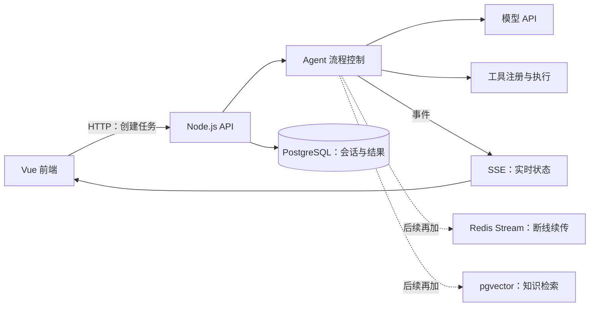

# Node + Vue Agent 学习路线

这份路线以当前仓库为起点，目标是**自己逐步做出一个能调用工具、能持续推送过程、能保存会话的 Agent 学习项目**。每一章只引入当前阶段需要的东西；先理解请求和状态如何流动，再使用框架或基础设施。

## 学习进度总表

完成后把对应方框改成 `[x]`。两种状态分开记录：**学习完成**表示你能自己解释并完成这一步；**功能已实现**表示项目里已经做出来并验证过。基础环境已搭好，其他功能目前都还没有实现。

| 步骤 | 要做什么 | 能学到什么 | 学习完成 | 功能已实现 |
|---|---|---|:---:|:---:|
| 0. 基础环境 | 启动 Vue 和 Node 项目，检查健康接口 | 项目结构、pnpm workspace、开发/构建脚本 | [x] | [x] |
| 1. TypeScript 与项目结构 | 阅读配置，做小练习并运行类型检查 | TypeScript、模块、异步函数、构建 | [x] | [ ] |
| 2. API 与前端请求层 | 后端定义接口并补 schema；前端封装 request、拦截器，再连接页面并同步 OpenAPI 到 Apifox | HTTP、请求封装、拦截器、校验、错误处理、加密边界、API 文档 | [x] | [x] |
| 3. 聊天界面（假数据） | 做会话、消息列表、输入和状态反馈 | Vue 响应式、组件拆分、表单和列表 | [x] | [x] |
| 4. 单轮模型问答 | Node 服务端调用模型并返回回答 | 模型 API、密钥管理、超时和错误处理 | [x] | [x] |
| 5. SSE 流式输出 | 后端推送文本，前端逐段显示 | HTTP 流、SSE、取消和连接生命周期 | [ ] | [ ] |
| 6. 工具调用 | 实现一个受限工具，由后端验证后执行 | 工具 schema、参数验证、权限边界 | [ ] | [ ] |
| 7. Agent 循环 | 串起模型判断、工具执行、结果回传与结束 | 多步状态流程、上下文、循环限制 | [ ] | [ ] |
| 8. PostgreSQL 持久化 | 保存会话、消息和任务，支持历史读取 | 关系建模、索引、迁移和数据约束 | [ ] | [ ] |
| 9. 任务与事件协议 | 设计 taskId、事件格式、订阅和取消接口 | 会话/任务/消息/事件的职责边界 | [ ] | [ ] |
| 10. Redis 断线续传 | 保存流事件并从客户端最后事件位置恢复 | Redis Stream、SSE 事件 ID、断点续传 | [ ] | [ ] |
| 11. 知识库检索（RAG） | 导入文档、切分、向量检索并展示引用 | embedding、检索、上下文组装和来源 | [ ] | [ ] |
| 12. 测试、评估与安全 | 测试工具和状态流程，评估固定问题集 | 自动化测试、模型评估、权限与成本 | [ ] | [ ] |
| 13. 部署与运行观察 | 配置生产环境并验证故障场景 | 部署、日志、健康检查和运行配置 | [ ] | [ ] |

## 目标架构



前端负责输入、展示和交互；后端负责密钥、模型调用、工具权限、任务状态与数据保存。模型可以建议下一步调用什么工具，但工具由后端校验并执行。

## 开始前：确认现有环境

当前基础环境已经包含：

- `apps/web`：Vue 3、TypeScript、Vite。
- `apps/server`：Node.js、TypeScript、Fastify。
- 根目录 pnpm workspace：统一安装依赖和运行检查。
- `GET /api/health`：只用于确认后端服务已启动。

运行 `pnpm dev` 启动前后端；前端地址为 `http://localhost:5173`，后端健康检查为 `http://localhost:3000/api/health`。改代码前先读对应文件，完成一章后再进入下一章。

## 第一阶段：打好前后端基础

### 第 1 步：认识项目和 TypeScript

**要做什么**

- 看懂根目录 `package.json`、`pnpm-workspace.yaml` 和两个应用各自的 `package.json`。
- 在前后端分别加一个很小的练习，熟悉导入、类型、函数、异步函数、错误处理和环境变量。
- 修改一个无业务风险的文案，再执行 `pnpm typecheck`、`pnpm build`。

**能学到什么**

- pnpm workspace 如何管理多应用项目。
- TypeScript 类型检查和生产构建分别解决什么问题。
- 前端与后端为什么分开安装、构建和启动。

**完成标准**：你能说清楚 `pnpm dev`、`pnpm typecheck`、`pnpm build` 的作用，并能独立定位一个类型错误。

### 第 2 步：做一个普通 HTTP API

**要做什么**

- 在 Fastify 中练习定义 GET、POST 路由。
- 为每个路由补充 Fastify schema，写清摘要、标签、参数和响应结构；确认它出现在 `/docs` 与 `/docs/json`。
- 在页面直接调用接口之前，先建立前端请求模块：集中配置 API base URL、超时、JSON 序列化和响应解析。
- 练习请求拦截器（例如统一添加请求 ID 或认证信息）与响应拦截器（统一解析成功数据、规范化错误、处理 401）。当前没有登录功能，不需要伪造 token 或实现 token 刷新。
- 将具体接口放进单独的 API 模块，由页面调用 API 方法；页面负责表单和展示，不直接拼装 HTTP 请求细节。
- 用请求模块调用问候接口，并显示加载中、成功结果和失败信息。
- 将 `http://localhost:3000/docs/json` 导入 Apifox；接口更新后，从 Apifox 的导入设置同步更新。
- 为错误响应、加载状态和输入校验各做一个小练习。
- 了解 HTTPS 传输加密与应用层字段加密的区别；除非接口协议或合规要求明确需要，不要自行把前端写死的共享密钥当作安全加密方案。
- 使用浏览器开发者工具查看请求地址、方法、状态码、请求体和响应体。

**能学到什么**

- HTTP 请求/响应、JSON、状态码和前后端分工。
- Vite 开发代理为什么让前端能用 `/api/...` 访问后端。
- Fastify Swagger 插件如何从路由 schema 生成 OpenAPI；Apifox 如何导入并同步这份契约。
- 请求模块、请求/响应拦截器和具体 API 方法之间的职责边界。
- HTTPS 如何保护传输过程；为什么放在浏览器代码里的密钥不能作为长期保密的服务端密钥。
- 后端必须校验客户端输入，不能把前端校验当作安全边界。

**完成标准**：页面通过统一请求模块调用后端；请求/响应拦截器按约定工作；错误输入会得到清晰反馈，页面能区分加载、成功和失败；接口能在 Swagger UI 和 OpenAPI JSON 中查看，并已导入 Apifox。若确有应用层加密要求，需先明确密钥管理、服务端解密、轮换与重放防护协议，再另行实现和验证。

### 第 3 步：完成基础聊天界面（先不接模型）

**要做什么**

- 做一个简单的会话区、消息列表和输入框。
- 先用本地假数据或固定响应练习：发送、清空输入、滚动到底部、空状态、发送中状态。
- 把页面拆成职责清楚的 Vue 组件；消息和输入使用明确的 props、事件或 `v-model` 合约。
- 按项目要求，界面保持简洁、克制、清晰，组件与间距尽量采用 shadcn-vue 常见习惯。

**能学到什么**

- Vue 3 Composition API、`<script setup>`、响应式状态和组件数据流。
- 表单输入、列表渲染、组件边界、空态和错误态。
- 为什么先用假数据做界面能把 UI 问题和模型问题分开。

**完成标准**：不接模型也能顺畅演示完整的输入与消息展示流程。

## 第二阶段：接入模型并理解 Agent

### 第 4 步：从后端调用模型，完成单轮问答

**要做什么**

- 选择一个支持你所在地区和支付方式的模型 API，阅读官方 SDK 文档。
- 由后端接收用户文本并调用模型，返回一条普通回答。
- 把 API Key 放在后端环境变量中，添加 `.env.example` 说明变量名；不要提交真实密钥。
- 记录请求耗时和错误类型，但不要把密钥或完整敏感请求写进日志。

**能学到什么**

- 模型 API 的请求、响应、token 用量、超时和错误处理。
- 为什么模型密钥只能由服务端保管。
- 普通模型调用与 Agent 控制流程的差别：单轮问答还没有工具调度。

**完成标准**：从 Vue 发消息，由 Node 服务端调用模型并返回回答；无效密钥和模型服务失败都能被明确处理。

### 第 5 步：实现流式输出

**要做什么**

- 先在后端把模型返回的文本增量转发给浏览器。
- 再在 Vue 中逐段显示文本，并处理完成、失败、用户取消和连接关闭。
- 练习检查请求头、事件格式和浏览器网络面板。
- 初版可以用 `fetch` 读取流；如果采用浏览器原生 `EventSource`，记住它只适用于 GET，不直接发送 POST 请求体。

**能学到什么**

- 流式 HTTP、SSE 事件、连接生命周期和取消机制。
- “模型还在生成”与“服务端连接断了”是不同状态。
- 流式回答需要增量更新，不能把每个片段误当作一条独立消息。

**完成标准**：回答逐字或逐段出现；完成、失败、取消都能收尾，不会让界面永久停在生成中。

### 第 6 步：理解工具调用

**要做什么**

- 先实现一个纯本地、低风险的工具，例如四则运算或查询固定数据。
- 定义工具名称、用途说明、参数 schema 和执行函数。
- 让模型提出工具调用请求；服务端验证工具名和参数后再执行。
- 把工具开始、结束、失败以及结果作为结构化事件展示在界面中。

**能学到什么**

- 工具调用不是模型直接执行代码，而是模型输出结构化意图、后端负责执行。
- 参数校验、允许列表、最小权限和工具错误处理。
- 工具结果如何回到模型上下文，成为下一步回答的依据。

**完成标准**：模型能在合适时请求指定工具，服务端拒绝未知工具或不合法参数，并把执行结果交回模型。

### 第 7 步：自己写一个最小 Agent 循环

**要做什么**

- 不急着上 Agent 框架，自己把“请求模型 → 判断回答或工具调用 → 执行工具 → 把结果交回模型”串起来。
- 明确一次任务的状态，例如 `queued`、`running`、`completed`、`failed`、`cancelled`。
- 设置最大循环轮数、超时和取消条件，避免无限调用。
- 为每次模型输出、工具调用和工具结果保留可追踪的事件。

**能学到什么**

- Agent 的核心是由程序控制的多步状态流程，不是单独一种模型。
- 对话上下文、工具结果和终止条件如何影响后续步骤。
- 为什么 Agent 要有轮数上限、超时和明确的结束状态。

**完成标准**：你能画出一次任务的状态变化图，并解释每个循环何时继续、何时结束。

## 第三阶段：保存会话并支持恢复

### 第 8 步：加入数据库，保存会话和消息

**要做什么**

- 使用 PostgreSQL 保存会话、消息和任务的基本信息。
- 先设计字段与关系，再实现创建会话、写入消息、读取历史的 API。
- 为会话归属、创建时间、消息角色和任务状态建立清晰的数据约束。
- 开发早期可用本地 PostgreSQL；迁移脚本和真实密钥不要放进版本库。

**能学到什么**

- 关系型数据建模、主键、外键、索引和迁移。
- 会话历史是持久数据；生成中的临时事件是另一种数据。
- 数据库失败时，任务和界面需要如何反馈。

**完成标准**：重启服务后，已保存的会话仍能读取；消息顺序稳定，数据归属可验证。

### 第 9 步：把任务和实时事件设计清楚

**要做什么**

- 让创建生成任务的接口返回独立的 `taskId`，不要把会话 ID 当作单次生成任务 ID。
- 设计统一事件类型，例如 `text_delta`、`tool_started`、`tool_finished`、`done`、`error`。
- 约定一个事件结构，包含事件 ID、任务 ID、类型、时间和数据载荷。
- 明确任务创建、SSE 订阅、任务状态查询和取消分别对应什么接口。

**能学到什么**

- 会话、消息、生成任务和流事件是相关但不同的实体。
- 事件协议如何让前后端可以独立开发和调试。
- SSE 连接承载实时传输，但不应成为唯一的数据记录。

**完成标准**：即使暂时没有 Redis，前后端也已经使用稳定的任务 ID 和事件格式。

### 第 10 步：用 Redis Stream 做断线续传

**要做什么**

- 只有在普通流式输出工作后再加入 Redis。
- 把任务事件写进 Redis Stream，并设置合理的保留时长或长度上限。
- SSE 发送事件 ID；客户端重连时携带最后收到的事件 ID，服务端从其后继续读取。
- 清理结束任务的活动状态，并处理事件过期、任务已结束和任务不存在等情况。
- 用“生成中断网后恢复”和“完成后再重连”两种场景验证行为。

**能学到什么**

- Redis Pub/Sub 与 Redis Stream 的区别：前者不保留断线期间错过的事件，后者可以读取保留的事件。
- `Last-Event-ID` 和断点续传的意义。
- Redis 用于短期事件传输和恢复；PostgreSQL 继续保存持久会话与结果。

**完成标准**：浏览器断线重连后不会重复显示已经收到的片段；已结束或过期任务有明确响应。

## 第四阶段：扩展能力与工程质量

### 第 11 步：加入知识库检索（RAG）

**要做什么**

- 支持导入少量文本或 Markdown 文件，提取文本并按段落切分。
- 为片段生成向量，保存文本、来源、权限和向量；可以使用 PostgreSQL + pgvector。
- 用户提问时先检索相关片段，再把片段和来源交给模型。
- 展示引用来源，并测试无相关材料时模型是否会承认无法从资料中找到答案。

**能学到什么**

- RAG 的基本链路：加载、切分、向量化、检索、上下文组装和生成。
- 向量检索是搜索辅助，不会自动保证回答正确。
- 文档权限必须应用于检索，不能只靠提示词约束。

**完成标准**：回答可以指出使用了哪些资料片段；无关问题不会被虚构的知识库内容误导。

### 第 12 步：测试、评估与安全边界

**要做什么**

- 为参数校验、工具执行、状态转换和错误处理写单元测试。
- 用 mock 模型测试 Agent 流程，避免每次测试都消耗真实模型额度。
- 建一组固定问题，记录工具选择是否合适、结果是否正确、耗时和成本。
- 检查提示注入、越权工具调用、超长输入、限流、超时、密钥和日志处理。

**能学到什么**

- 测试 Agent 的确定性逻辑与评估模型输出之间的区别。
- 安全控制必须落实在服务端校验、工具权限和数据访问上。
- 成本、延迟、质量和安全需要一起衡量。

**完成标准**：关键流程有自动化测试；你能复现并定位一次工具失败或模型失败。

### 第 13 步：部署和运行观察

**要做什么**

- 分别构建前端和后端，配置生产环境变量与 HTTPS 反向代理。
- 部署 PostgreSQL；如果做了续传，再部署 Redis。
- 设置日志字段、健康检查、错误告警和资源限制。
- 在测试环境验证重启、模型不可用、数据库不可用和客户端断开的行为。

**能学到什么**

- 开发环境与生产环境的差异、部署配置和服务运行状态观察。
- 任务运行时间可能超过普通请求，部署时需要检查代理超时和连接保持设置。
- 多实例部署时，进程内存不能作为共享任务状态存储。

**完成标准**：服务可从干净环境按文档部署，并能通过日志和健康检查判断运行状态。

## 推荐学习节奏

按顺序做，不要求一次完成。每一步尽量采用“先画流程 → 写最小实现 → 手动验证 → 写下问题 → 再继续”的节奏。第 1–7 步完成后，就已经理解并做出了一个最小 Agent；第 8–10 步解决持久化和断线恢复；第 11–13 步再扩展知识库、质量和上线能力。

**第一版暂时不需要**：多 Agent 协作、复杂工作流平台、Kafka、Kubernetes、独立向量数据库和多租户权限系统。先把单 Agent、单工具、单任务的闭环做扎实，再根据真实需求扩展。

## 每章的学习记录模板

```text
章节：
我实现了什么：
请求/数据如何流动：
遇到的错误及原因：
我还不确定的点：
进入下一章前，我能独立解释：
```
